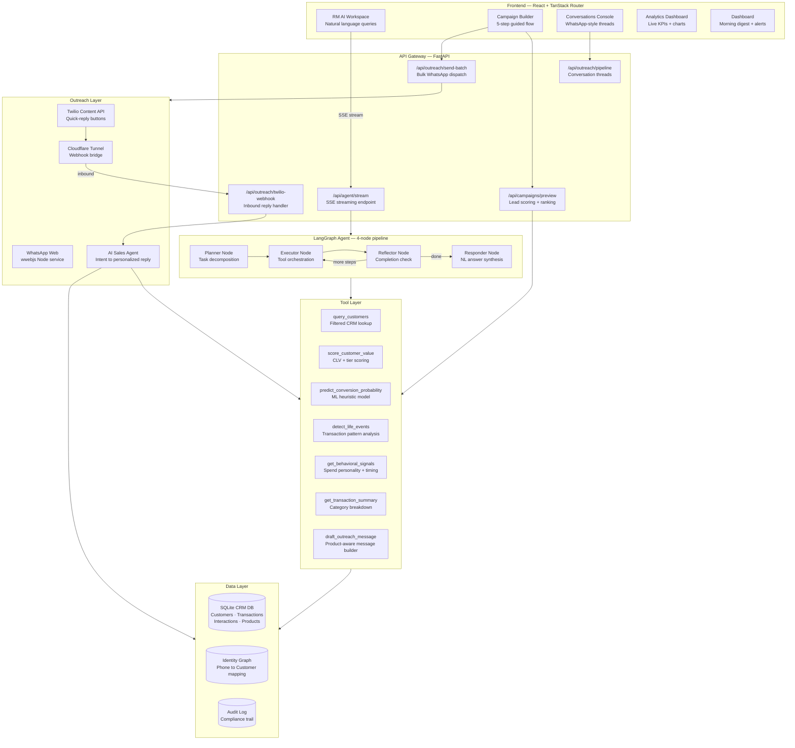
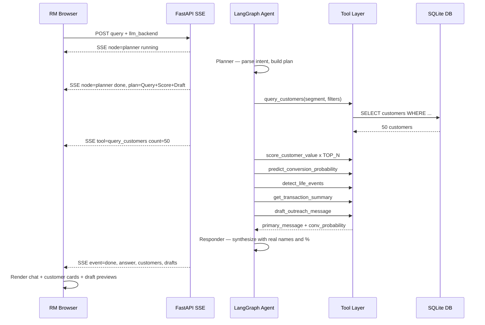
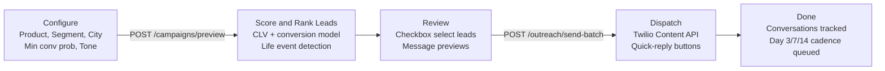
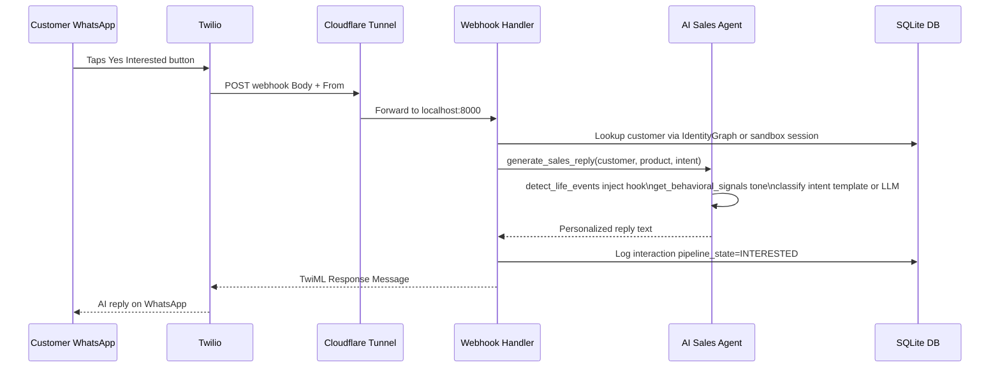
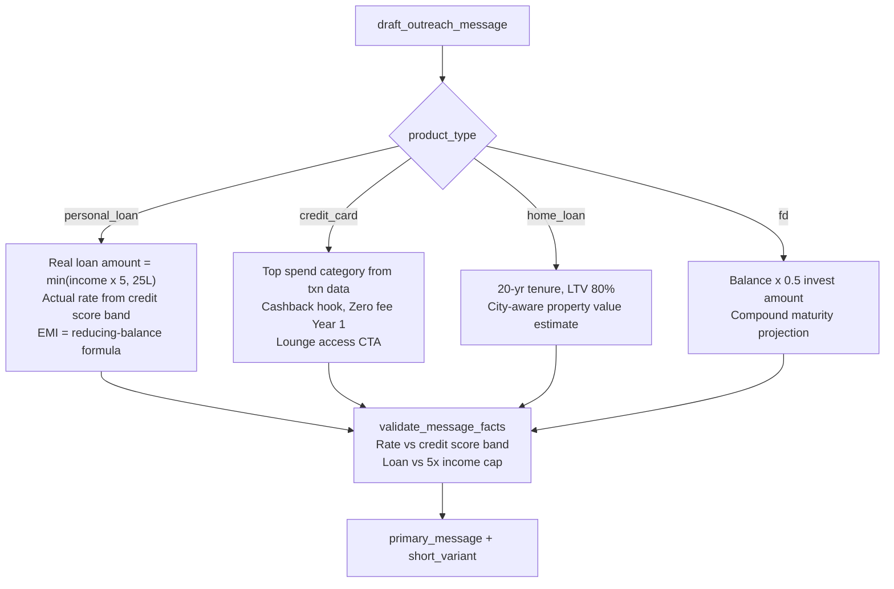
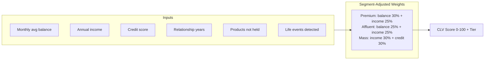

# BankRM AI — Agentic Banking CRM

> **Agentic AI system that helps Relationship Managers identify high-value customers, predict loan conversion, and send hyper-personalized WhatsApp outreach — all from a single natural-language query.**

[](https://python.org)
[](https://fastapi.tiangolo.com)
[](https://github.com/langchain-ai/langgraph)
[](https://react.dev)

---

## Corporate edition & Vietnamese UI

- **Vietnamese UI** is the default; switch with the `VI / EN` button in the header (reloads the page).
- **Corporate edition** (`/corp`): 220 simulated Vietnamese corporate/FDI customers, explainable cross-sell scoring
  (working capital, L/C, UPAS, guarantees, FX, payroll, cash management, deposits), risk alerts (limit expiry, utilisation,
  inflow decline, debt group), pipeline board, and an RM assistant that understands Vietnamese/English/Chinese queries and drafts
  Zalo / email / call scripts in Vietnamese, Chinese or English. Backend: `backend/src/corporate`, API under `/api/corp/*`.
  Tables are created and seeded automatically on first start (existing data is never overwritten).

## Table of Contents
1. [What it does](#what-it-does)
2. [Architecture](#architecture)
3. [Execution Flow](#execution-flow)
4. [Tool Design & Usage](#tool-design--usage)
5. [Key Design Decisions](#key-design-decisions)
6. [Trade-offs & Limitations](#trade-offs--limitations)
7. [Setup & Run](#setup--run)
8. [Project Structure](#project-structure)

---

## What it does

A Relationship Manager types:

> *"Find high-value customers likely to convert for a personal loan this month and generate personalized WhatsApp messages."*

The system autonomously:

1. **Parses** intent — extracts filters (segment, product, city, timeline)
2. **Queries** the CRM database for matching customers
3. **Scores** each customer with a CLV model + conversion probability engine
4. **Detects life events** from transactions (wedding spend, salary jump, medical bills)
5. **Drafts** personalized WhatsApp messages with real loan amounts, rates, and EMIs
6. **Sends** via Twilio with interactive quick-reply buttons (✅ Yes / 📞 Call Me / ❌ Not Now)
7. **Replies** automatically when customers respond — running a live AI sales agent
8. **Tracks** every conversation in a pipeline (Contacted → Engaged → Interested → Converted)

---

## Architecture



---

## Execution Flow

### 1 — RM Query (Workspace)



### 2 — Campaign Builder



### 3 — WhatsApp Reply Loop



---

## Tool Design & Usage

Each tool is a **pure Python function** registered in `tool_registry.py`. The agent calls them by name with structured arguments. No tool has side effects beyond DB reads — outreach is handled separately.

| Tool | Input | Output | Used By |
|------|-------|--------|---------|
| `query_customers` | segment, city, min_income, min_credit_score, has_credit_card, limit | `List[CustomerDict]` | Executor — query step |
| `score_customer_value` | customer_id | `{score, tier, factors, weights}` | Executor — scoring step |
| `predict_conversion_probability` | customer_id, product_id | `{probability, tone_hint, signals}` | Executor — draft step |
| `detect_life_events` | customer_id | `[{event_type, confidence, evidence}]` | Campaign preview + Sales agent |
| `get_behavioral_signals` | customer_id | `{spend_personality, best_contact_time, emi_risk}` | Sales agent personalization |
| `get_transaction_summary` | customer_id, days | `{total_spend, categories, avg_monthly}` | Executor — draft step |
| `recommend_products` | customer_id | `[{product_id, affinity_score, reasons}]` | Executor — optional step |
| `draft_outreach_message` | customer_name, product_id, framework, tone, customer_id | `{primary_message, short_variant, offer_expiry}` | Executor — draft step |

### Message Builder — Product-Aware Dispatch



### CLV Scoring Model



### Life Event Detection (7 signals)

| Signal | Transaction Evidence |
|--------|---------------------|
| `WEDDING_LIKELY` | Jewellery + catering + venue spend spike |
| `PROMOTION_LIKELY` | Salary > 1.3× last 3-month average |
| `MEDICAL_EXPENSE` | Hospital / pharmacy spend > ₹50K |
| `HAS_CHILDREN` | School / toys / pediatrics spend |
| `TRAVEL_FREQUENT` | 3+ airline or hotel transactions/month |
| `LIFESTYLE_SPENDER` | Luxury retail > 20% of spend |
| `MEDICAL_LOAN_CANDIDATE` | Medical + low balance combo |

---

## Key Design Decisions

### 1. LangGraph 4-node pipeline over a single prompt
Each node has one responsibility. The Executor loops (Reflector sends it back) until all plan steps are done — enabling multi-tool orchestration without prompt engineering tricks. SSE streaming makes each node visible to the RM in real time.

### 2. Tool-first, LLM-second
Every common intent (score, query, draft) is handled by a deterministic tool. The LLM is only called for planner reasoning and final response synthesis. This eliminates hallucinated loan amounts, rates, and EMIs.

### 3. Product-aware message builders
Four separate builder functions instead of one generic template. Credit cards need cashback hooks. Loans need real EMI calculations. A single template either leaves fields blank (`Amount: ₹—`) or gets filled with wrong product data.

### 4. Sandbox session persistence via DB fallback
In-memory `_sandbox_sessions` dict is fast but wipes on restart. On cold start the webhook falls back to querying the most recent outreach interaction from the DB, reconstructs context, and caches it — so button replies work immediately after a restart without re-sending messages.

### 5. SSE streaming over polling
`/api/agent/stream` emits node-level events as the LangGraph pipeline executes. Agent runs take 10–30 seconds — SSE gives the RM live feedback (`📋 Planning → ⚙️ Executing (50 customers) → ✍️ Synthesizing`) with no extra infrastructure.

### 6. LLM provider cascade
Gemini → Ollama → deterministic template fallback in the sales agent. If the API quota is exhausted or the network is down, the template still produces a correctly personalized reply with the customer's real name, product, and amounts.

---

## Trade-offs & Limitations

| Area | Current approach | Trade-off |
|------|-----------------|-----------|
| **Database** | SQLite | Zero-config setup. Not suitable for multi-tenant or high-write production. Swap `DATABASE_URL` for Postgres. |
| **Tunnel** | Cloudflare quick tunnel | URL changes on every restart — must re-update Twilio webhook manually. A named tunnel or reserved domain fixes this. |
| **Conversion model** | Weighted heuristic (income, balance, credit score, life events) | No historical conversion labels so cannot train a real classifier. Designed to swap in an sklearn model when labels exist. |
| **Session memory** | In-memory dict + DB fallback | Multi-process deploys (gunicorn workers) do not share the dict. Move to Redis for production. |
| **Agent LLM calls** | 1–2 per run (planner + responder) | Executor is fully deterministic — zero LLM calls for tool dispatch. Efficient but less flexible for novel query types. |
| **WhatsApp delivery** | Twilio sandbox | Requires customer opt-in to the sandbox number. Production needs approved message templates. |
| **Personalization data** | Transaction history in local DB | Accuracy improves significantly with bureau data, behavioral telemetry, and longer history. |

---

## Setup & Run

### Prerequisites

| Requirement | Version |
|------------|---------|
| Python | 3.11 or 3.12 (3.13 not supported — pinned scikit-learn/numpy do not build) |
| Node.js | 18+ |
| Git | any |
| Ollama (optional) | latest |

---

### 1. Clone

```bash
git clone https://github.com/namanchitkara2/bankrm-ai.git
cd bankrm-ai
```

### 2. Backend

```bash
cd backend
python3 -m venv .venv && source .venv/bin/activate
pip install -r requirements.txt

cp .env.example .env
# Edit .env — set at least one LLM backend key
```

**Choose your LLM backend** in `.env`:

```bash
# Option A — Google Gemini (recommended, free tier available)
LLM_BACKEND=gemini
GEMINI_API_KEY=your_key          # https://aistudio.google.com/app/apikey

# Option B — NVIDIA NIM (free credits, 70B model)
LLM_BACKEND=nvidia
NVIDIA_API_KEY=your_key          # https://build.nvidia.com

# Option C — Ollama (fully local, no API key needed)
LLM_BACKEND=ollama
OLLAMA_MODEL=gemma3:4b           # run: ollama pull gemma3:4b
```

**Seed and start:**

```bash
python3 data/seed_db.py          # creates banking_crm.db with synthetic data
python3 -m uvicorn src.api:app --host 0.0.0.0 --port 8000 --reload
```

### 3. WhatsApp (optional — for real sending)

**Option A — WhatsApp Web (free, scan QR):**
```bash
cd backend/whatsapp-service
npm install && node server.js    # scan QR code in terminal
```

**Option B — Twilio (button replies, webhook):**
```bash
# In .env:
SENDER_BACKEND=twilio
TWILIO_ACCOUNT_SID=ACxxx
TWILIO_AUTH_TOKEN=xxx
TWILIO_PHONE_NUMBER=+14155238886
TWILIO_WHATSAPP_CONTENT_SID=HXxxx

# Expose webhook to internet
cloudflared tunnel --url http://localhost:8000 --no-autoupdate
# Paste *.trycloudflare.com URL into Twilio console:
# Messaging > Sandbox > "When a message comes in" >
#   https://xxx.trycloudflare.com/api/outreach/twilio-webhook
```

### 4. Frontend

```bash
cd frontend
npm install
npm run dev                      # http://localhost:5173
```

### 5. Verify

```bash
curl http://localhost:8000/api/health
# {"status":"ok","timestamp":"..."}
```

Open **http://localhost:5173** and try:
- **Dashboard** — morning digest, churn alerts, cross-sell opportunities
- **RM AI Workspace** — type *"Find affluent customers for credit card and draft messages"*
- **Campaign Builder** — Personal Loan → Find Best Leads → Review → Send
- **Conversations** — click any contact to see the full WhatsApp thread

---

## Project Structure

```
bankrm-ai/
├── backend/
│   ├── src/
│   │   ├── api.py                    # FastAPI routes — agent, campaigns, pipeline, webhook
│   │   ├── database.py               # SQLAlchemy models
│   │   ├── config.py                 # Pydantic settings from .env
│   │   ├── rm_agent/
│   │   │   ├── graph.py              # LangGraph graph assembly
│   │   │   ├── nodes.py              # Planner, Executor, Reflector, Responder
│   │   │   ├── state.py              # RMAgentState TypedDict
│   │   │   └── tool_registry.py      # Tool name → function mapping
│   │   ├── tools/
│   │   │   ├── customer_tool.py      # query_customers
│   │   │   ├── scoring_tool.py       # score_customer_value, detect_life_events
│   │   │   ├── message_tool.py       # draft_outreach_message, product builders
│   │   │   ├── outreach_tool.py      # send_outreach_message, Twilio integration
│   │   │   ├── sales_agent.py        # generate_sales_reply, intent classifier
│   │   │   ├── transaction_tool.py   # get_transaction_summary
│   │   │   └── product_tool.py       # recommend_products
│   │   └── llm/
│   │       ├── base.py               # LLMProvider abstract class
│   │       ├── gemini.py             # Google Gemini
│   │       ├── nvidia.py             # NVIDIA NIM
│   │       └── ollama.py             # Local Ollama
│   ├── whatsapp-service/             # Node.js wwebjs WhatsApp bridge
│   ├── requirements.txt
│   └── .env.example
├── frontend/
│   ├── src/
│   │   ├── components/pages/
│   │   │   ├── WorkspacePage.tsx     # RM AI chat + live SSE workflow rail
│   │   │   ├── CampaignPage.tsx      # 5-step campaign builder
│   │   │   ├── ConversationsPage.tsx # WhatsApp thread viewer + pipeline
│   │   │   ├── DashboardPage.tsx     # Morning digest + churn + cross-sell
│   │   │   └── AnalyticsPage.tsx     # Live KPIs + Recharts
│   │   └── lib/api.ts                # Typed API client
│   └── package.json
└── README.md
```

---

## Tech Stack

| Layer | Technology |
|-------|-----------|
| Agent orchestration | LangGraph 4-node pipeline |
| LLM backends | Google Gemini · NVIDIA NIM · Ollama |
| API server | FastAPI + Server-Sent Events |
| Database | SQLite via SQLAlchemy ORM |
| Frontend | React 18 + TanStack Router + Tailwind CSS |
| UI components | shadcn/ui |
| Charts | Recharts |
| Animations | Framer Motion |
| WhatsApp | Twilio Content API · WhatsApp Web (wwebjs) |
| Tunnel | Cloudflare quick tunnel |
